# aws-three-tier-app

## Network architecture
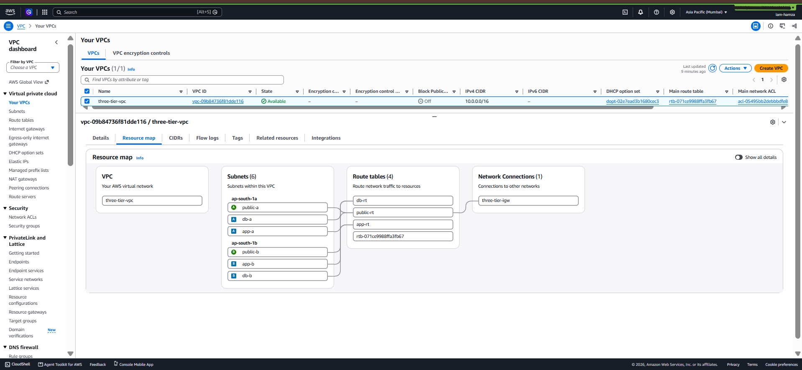

## 2. Compute (EC2, Nginx, pm2)
Private EC2 instance with no public IP, accessed through SSM Session Manager (no SSH keys, no open ports).

**IAM role (least privilege):** SSM and CloudWatch agent policies only.
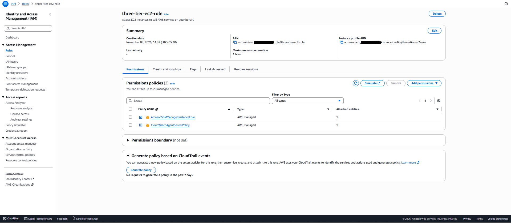

**Outbound internet through NAT gateway (app subnets only):**
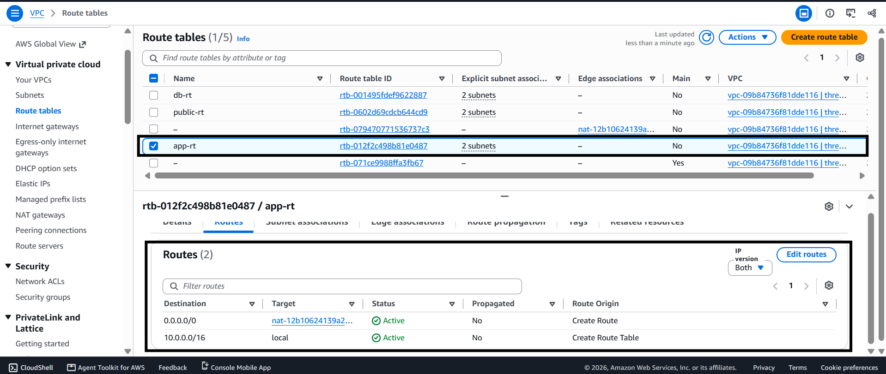

**Instance in the private subnet, no public IP:**
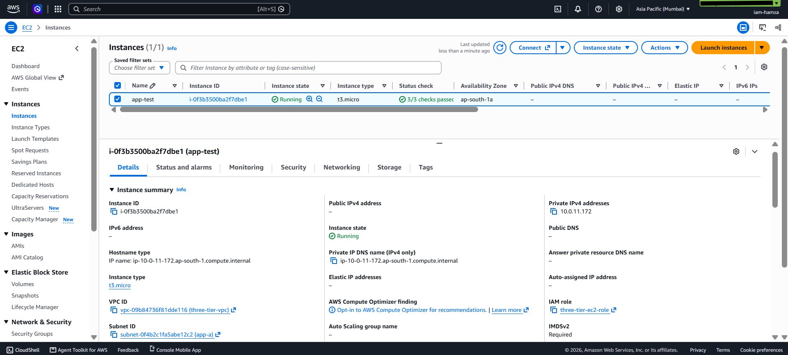

**Nginx reverse proxy to a Node app managed by pm2:**
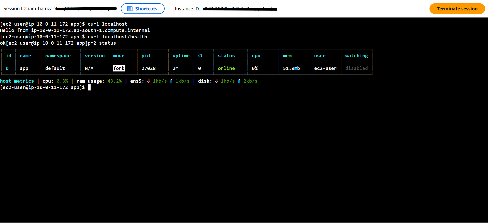

## 3. Database (RDS MySQL)
Private RDS instance, reachable only from the app security group. Credentials are managed by AWS Secrets Manager and read at runtime through the instance role.

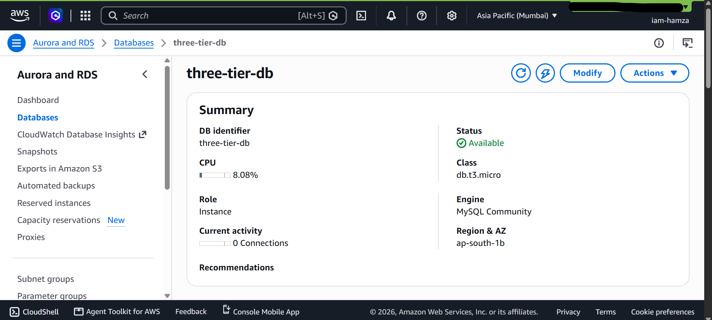
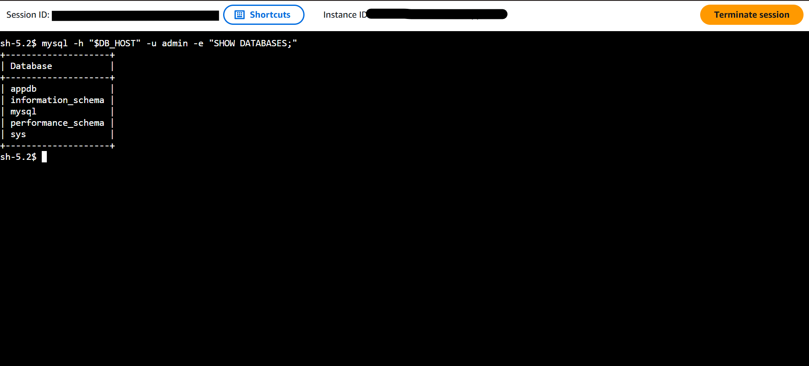

## 4. Load balancing and Auto Scaling
An Application Load Balancer in the public subnets forwards HTTP traffic to EC2 instances in the private app subnets. An Auto Scaling group keeps 2 instances running across two Availability Zones (min 2, max 3), scales on 50% average CPU, and replaces instances that fail the `/health` check.

**Target group: both targets healthy, one in each AZ:**
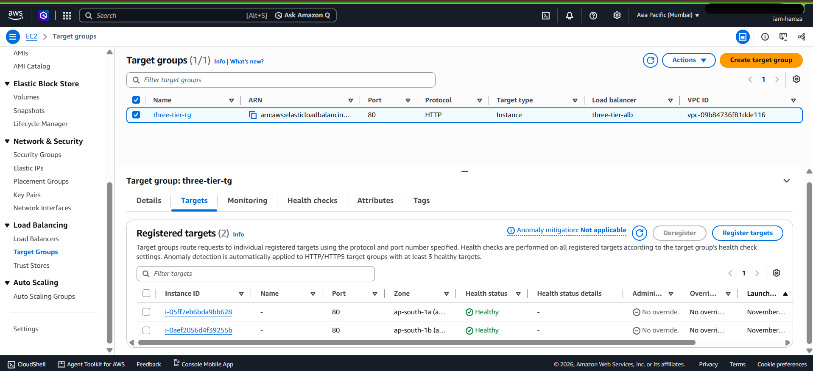

**ALB resource map (listener, target group, targets):**
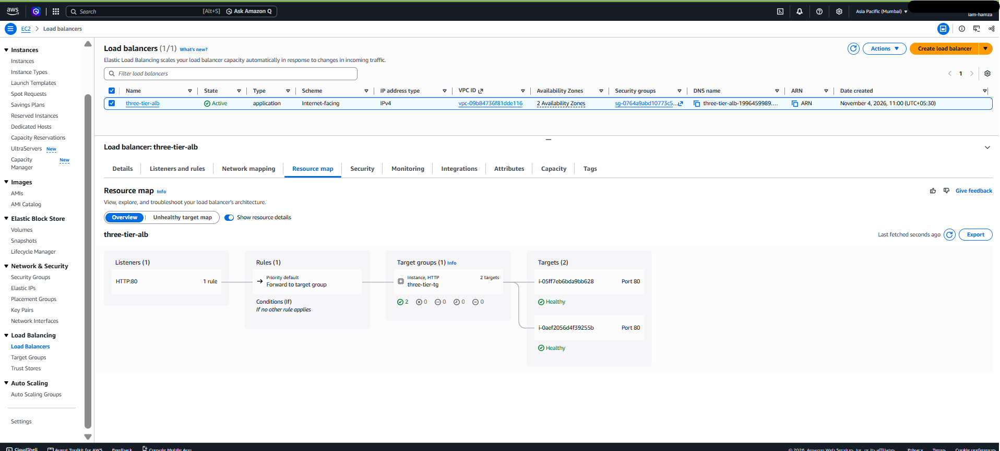

**Request served through the ALB by a private instance:**
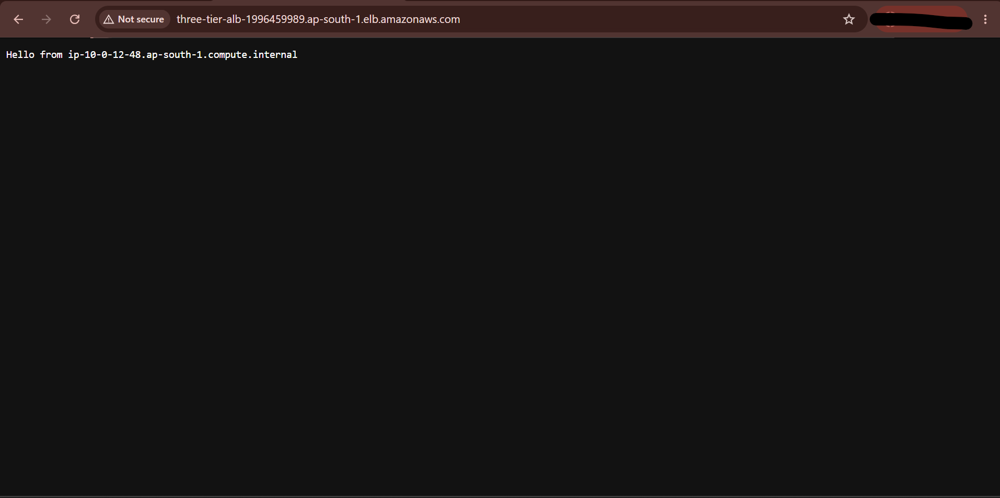

**Traffic distributed across both instances:**
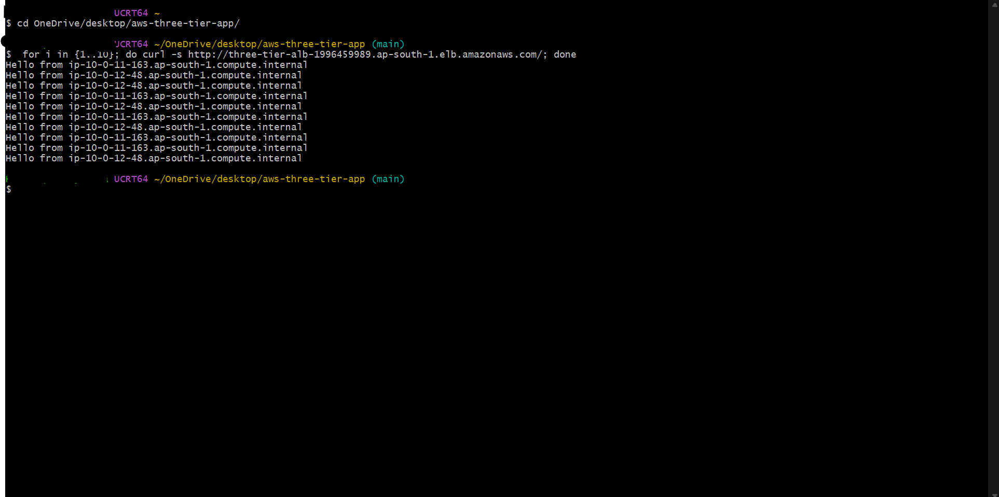

**Auto Scaling group with 2 instances in service:**
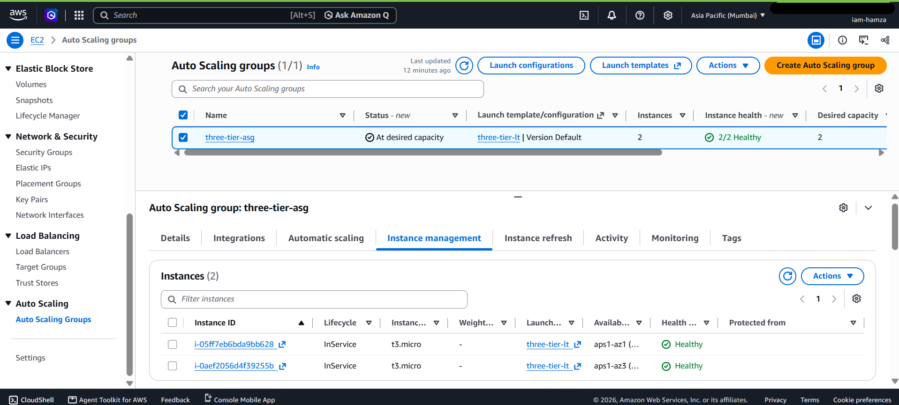

